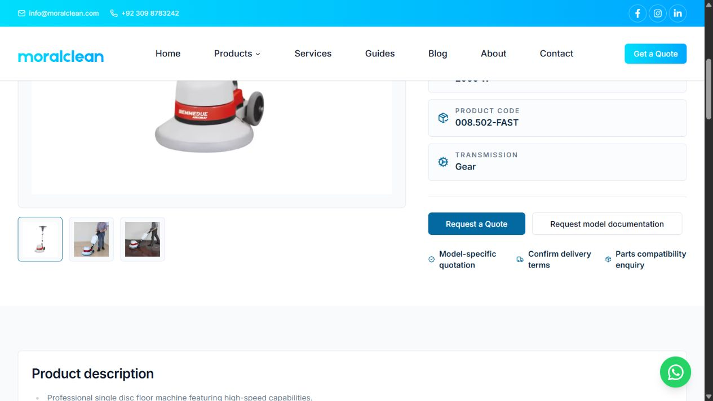

# Commercial SEO implementation — 11 October 2026

Status: implemented and tested locally; no push, preview deployment or production release.

Branch: `codex/seo-commercial-2026-10-11`. Base: research commit `17b32dd` on the existing preview application. Implementation commit: `4cb72c3`. The starting working tree was clean. Master remains `253902d05d522a747c589130875360117c40e815`.

Read-only Vercel inspection confirmed preview.moralclean.com still points to preview branch commit `4640859c2c12f0102cb067f46ab21127b3287905`, deployment `dpl_A1trRHfY9tkXfLXP8CeZbjPckC4U`. These new changes are not deployed there.

## Five deliverables

1. **Pagination hardening.** Catalogue, category and blog metadata/rendering reject malformed, fractional, negative and unsafe page values before database access. Shared range recovery handles PGRST103 without displaying unrelated first-page products; real permission/database failures remain errors. ID tie-breaking stabilizes pagination. Valid ranges make one request; invalid ranges need at most one additional bounded count-recovery request. Existing preview's original pagination fix was retained and strengthened.
2. **Single-disc commercial landing page.** /products/category/single-disk-machine targets single disc floor machines in Pakistan. It has a concise dedicated title/description, equipment-specific H1, practical applications, floor-finish/accessory limits, water-recovery considerations and direct equipment/service links.
3. **Ride-on commercial landing page.** /products/category/ride-on-scrubber-dryer targets ride on scrubber dryers in Pakistan. It explains route suitability, access restrictions, configuration and shift planning, without presenting theoretical productivity as guaranteed site output. Existing model comparisons, category quotation and guide links remain.
4. **Product documentation and purchasing trust.** The shared product template now provides a working model-documentation enquiry when no valid HTTPS brochure exists. Unsupported distributor, nationwide-service and original-parts badges were replaced with factual procurement prompts. Parts and bottom-of-page enquiries preserve the model. Product cards contain the entire photograph rather than cropping it. Existing Product markup/specification rendering remains; no prices, offers, ratings or warranty terms were invented.
5. **Quotation context and measurement.** Documentation/parts requests prefill model-specific messages and the appropriate contact subject. Quote-click events identify their source category/product; stored contact-enquiry events receive only the server-resolved product slug. Names, phone numbers, messages and enquiry-purpose query strings are not added to analytics.

Highest-priority product verified through the new journey: /products/biemmedue-ms-17-fast-single-disc-floor-machine. The shared changes apply to all 36 products, including the other Biemmedue single-disc models and MC522.

No new articles were created: the existing preview guides already cover the relevant comparisons and maintenance intents. No database records were changed. Technical/model figures remain catalogue data rather than newly verified manufacturer facts.

## Files changed

| Area | Files |
|---|---|
| Pagination and queries | src/lib/pagination.ts; src/lib/queries/read-page.ts; src/lib/queries/products.ts; src/lib/queries/blog.ts |
| Listing routes | src/app/(public)/products/page.tsx; src/app/(public)/products/category/[slug]/page.tsx; src/app/(public)/blog/page.tsx |
| Commercial content and cards | src/content/categories.ts; src/components/products/CategoryBuyingAdvice.tsx; src/components/products/ProductCard.tsx |
| Product/contact journey | src/lib/product-enquiry.ts; src/app/(public)/products/[slug]/page.tsx; src/app/(public)/contact/page.tsx; src/components/contact/ContactForm.tsx |
| Measurement | src/lib/analytics.ts; src/components/analytics/PostHogProvider.tsx |
| Tests and verification | tests/catalog-pagination.test.js; tests/product-enquiry.test.js; scripts/verify-commercial-seo.mjs |
| Generated sitemap | public/sitemap-0.xml, regenerated by the existing postbuild configuration to include current preview service/guide routes |
| Evidence | This report, the two linked verification JSON files, screenshot and SEO README index |

## Verification results

- `bun test`: **17 passed**, zero failed, 70 assertions. Tests exercise the real Supabase query builder against a deterministic REST transport, including valid ranges, PGRST103 recovery, empty collections and permission/recovery failures. Contact tests mock database/email writes.
- `bunx tsc --noEmit`: passed.
- `bun run lint`: passed without warnings.
- `bun run build`: passed, including postbuild sitemap generation and 90 generated pages. Nonfatal warnings: Webpack large-string cache serialization and the existing edge-runtime/static-generation warning.
- [Full local verification](commercial-full-verification-2026-10-11.json): 68 sitemap URLs, 36 product pages, 12 exclusion checks, 68/68 reachable pages, 1,376 internal edges, zero errors.
- [Focused commercial verification](commercial-verification-2026-10-11.json): 32 checks, zero errors. Includes invalid/empty pagination, valid page-two/three canonicals, target category content, Product JSON-LD syntax, documentation/parts prefills, representative optimized image and permanent www redirect preserving path/query.
- Configuration checks: preview global noindex header present; production global noindex absent. No live firewall/domain/protection settings were changed.
- Browser: single-disc, ride-on, product and documentation contact samples at 390 × 844 had document width 375, with no horizontal overflow. Ride-on desktop document width 1,265 inside a 1,280 viewport. The model documentation control navigated to the correct prefilled contact form. No form, call or WhatsApp message was submitted; sampled browser error logs were empty.
- `git diff --check`: passed.

The initial type check failed because TypeScript tests lacked bun:test declarations. Tests were converted to the existing JavaScript format; subsequent type/lint/build checks passed. Analytics was disabled for the local verification build, so browser checks did not generate production measurement events.

## Plugins and skills actually used

- **Vercel plugin:** read-only alias/deployment inspection confirmed the current preview branch and release. No deployment or configuration mutation.
- **Unified Computer Use plugin:** local desktop/mobile browser inspection, documentation-link navigation and screenshot capture.
- **Supabase workspace skill:** checked current changelog and [range documentation](https://supabase.com/docs/reference/javascript/range); applied bounded [PostgREST range-error handling](https://docs.postgrest.org/en/stable/references/errors.html). No Supabase MCP writes.
- **Vercel React best-practices skill:** reviewed component fetching, hook dependencies, accessible controls, responsive overflow and client serialization. Content remains server-rendered; the new helper does not add a client dependency.

GSC/Semrush/Serpstat were not called again; selection uses the completed research rather than another research cycle.

## Remaining risks and release boundary

This is local production-build verification against public catalogue reads, not verification of a newly deployed preview. The branch inherits earlier unreleased preview changes; review that release as well as this incremental batch before promotion.

Manufacturer datasheets, warranty/authorization evidence and missing MC522 structured specifications remain unresolved. Existing catalogue fields require source review; for example, MS17 FAST's width field contains 440 mm with a parenthetical 20-inch value, which is inconsistent if intended as a unit conversion. No guessed correction or database write was made.

The existing Product schema is factual catalogue markup without fabricated Offers/reviews; rich-result eligibility is not guaranteed. Lead qualification, attribution persistence and quotation/sale outcomes still need a separate sales-data workflow. Client event ingestion was not tested against live PostHog; server-recording behavior is covered by mocked tests.

Historical 403/image audit counts did not justify weakening protection or disabling image optimization. Current optimizer checks succeeded. Test-product 404s, empty-category exclusion, faceted noindex, canonicals and internal-link accessibility passed regression checks.

Neither rankings, organic traffic, conversions nor field Core Web Vitals have been shown to improve. Production remains on the approved master release. Preview and production share records; a code rollback does not roll back database data.
