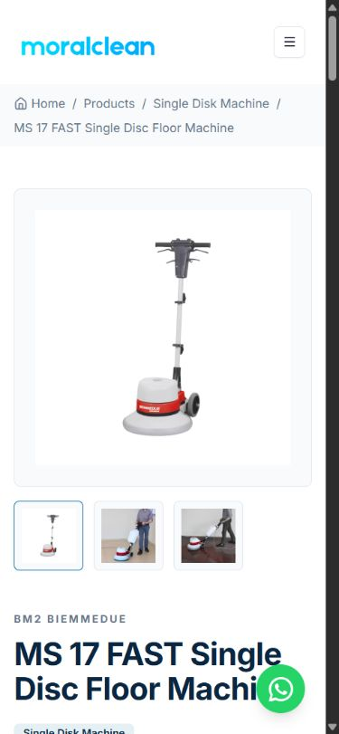
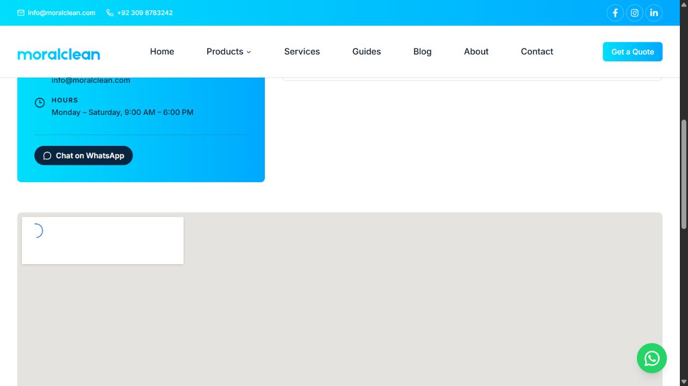

# Independent SEO QA and preview release — 11 October 2026

The preview release passed the executable technical checks. **Production release remains on hold.** Manufacturer evidence, real notification delivery, live analytics ingestion and complete observability are not certified by these tests. No production deployment, promotion, master push or master merge was performed.

## Exact release

- Tested application/preview commit: `16e5e1811647664fcf8199709b09eb4243685c5a`.
- Feature branch: `codex/seo-commercial-2026-10-11`. The application above is preserved remotely; subsequent QA artifacts and the isolated test helper do not change application source.
- Preview branch: `preview`, fast-forwarded from `4640859c2c12f0102cb067f46ab21127b3287905`.
- Vercel deployment: `dpl_9KwkwDiHqAtiTa9Ea628CMQqKdiq`, **READY**, preview environment.
- [Immutable deployment](https://moral-clean-igyb1ngc1-burhan-uddins-projects-91e8a924.vercel.app).
- [Preview domain](https://preview.moralclean.com), verified domain, configured for the preview Git branch, confirmed to resolve to that deployment.
- Production remains master `253902d05d522a747c589130875360117c40e815`, deployment `dpl_Eet82YisYPevDFQQDFHyFJttNndE`.
- Both remote heads were checked before and after the update. Preview was an ancestor of the feature head. A normal non-forced push preserved unrelated history. No master command mutated the branch.

[Release-state evidence](qa-release-state-2026-10-11.json).

## Validation matrix

FAIL below means the specified assurance is incomplete; it does not mean a new production error was observed.

| Validation area | Result | Evidence and limits |
|---|---|---|
| Source, logic and release diff | PASS | Reviewed the combined master-to-feature release, not only the last feature commit. [52-source-file inventory](qa-source-review-inventory-2026-10-11.json). Known conflicting specification and unsupported promises corrected. |
| Bun checks | PASS | 18 tests, 74 assertions, zero failures; TypeScript, lint, production build and sitemap generation passed. 90 static-generation entries. |
| Rendered technical SEO | PASS | All 68 sitemap pages: 200, one H1, one nonempty description, unique titles/descriptions, production canonical, crawlable application HTML and applicable parsed JSON-LD. |
| Internal navigation and assets | PASS | 68/68 reachable from home, 1,376 sitemap-page link edges; 110 actual page image URLs returned 200; all 14 guide social images decoded as 1200 × 630 PNG. |
| Preview isolation and branch identity | PASS | Alias resolves to expected READY commit. All 68 preview pages returned X-Robots-Tag: noindex. Production homepage returned 200 without global noindex. Protection remains enabled. |
| Desktop/mobile application regression | PASS | Chromium-based browser at 1280 × 900 and 390 × 844. Navigation, filter/search, page-two, category/product, guide/service and empty-state samples passed. No sampled horizontal overflow or broken visible image. This is not an exhaustive cross-browser or WCAG certification. |
| Contact/quotation application journeys | PASS | Invalid contact rejected. Real browser → Next server action → isolated database/email sinks → success UI passed for model documentation and category quotation. Unit tests cover saved/failed/honeypot paths. |
| Real persistence, delivery and analytics ingestion | FAIL | External writes were intercepted. Actual Supabase storage, Resend delivery and PostHog ingestion were not tested in the shared live environment. |
| Runtime error sampling | PASS | Vercel returned no error/fatal records for this deployment in the requested recent 30-minute window after the crawl. This is a bounded observation, not proof of permanent error absence. |
| Quantitative performance and Sentry assurance | FAIL | Function metrics query returned payment_required / Observability Plus required. No authenticated Sentry diagnostics were available. No field CWV improvement was established. |
| Manufacturer/business specification certification | FAIL | MS17 conflicting width is withheld, not guessed. Other catalogue specifications, MC522 missing structured fields, authorization/warranty claims and location-specific serviceability still require authoritative business/manufacturer evidence. |
| Production search-results improvement | FAIL | Not demonstrated and not measurable from this preview. Baseline was verified; the monitoring plan below is ready. |

## Resolved findings

1. **Conflicting MS17 FAST dimension.** The shared record says 440 mm with a parenthetical 20-inch value; those are not equivalent. The field is withheld in both the product specification table/JSON-LD and category comparison. Other fields remain. Four assertions cover the narrowly scoped exclusion. The shared database was not changed; this is not a data correction.
2. **Unsupported commercial promises.** Homepage authorization, nationwide service, twenty-year expertise and unconditional warranty/support claims were replaced with model-specific quotation and confirmation wording. Contact's two-hour response and unconditional on-site promise were also replaced. Product badges had already been corrected in the feature implementation and were independently checked.
3. **Search accessibility.** Product search now has an accessible name; the rendered control and search empty state were tested.
4. **Duplicate database work.** Product and blog list caches now have React request memoization around the existing persistent caches. Identical normalized metadata/render arguments reuse a result within the request. Existing 900-second catalogue data caching, bounded ranges, genuine error propagation and stable ordering remain.
5. **Staging identity.** Anonymous browser access reached Vercel login. Authenticated CLI crawls reached MoralClean, including the expected new category headings and product content. The old Serpstat preview audit's Vercel login/marketing resources are not evidence of broken MoralClean images.

[Local crawl](qa-local-verification-2026-10-11.json), [32 focused commercial checks](qa-commercial-verification-2026-10-11.json), [deployed release crawl](qa-preview-release-verification-2026-10-11.json), [independent HTTP/header/image audit](qa-preview-http-2026-10-11.json), [decoded social images](qa-preview-guide-images-2026-10-11.json).

## Page inventory and intent

Compared with the approved master/live baseline: 51 sitemap URLs became 68. There are **18 new routes**: the guide hub, 14 distinct equipment guides and 3 service detail pages. These were inherited from the earlier preview work; the commercial implementation and this QA phase did not add another article batch.

The 50 retained sitemap routes were checked: homepage, about, contact, product and blog listings, service hub, eight eligible categories and 36 products. Product/category shared-template changes therefore received page-by-page output checks.

The empty cleaning-chemicals category was removed from the sitemap and remains a 200 noindex route. Steam remains an enquiry-based commercial landing page with no invented model stock or specifications. No route was deleted in this phase. Removed historical test products/posts continue to return 404.

[Exact created/retained/excluded route list](qa-page-inventory-2026-10-11.json). Guides cover buying, comparisons and maintenance; categories retain transactional equipment intent and services retain assessment/parts intent. No duplicate page titles or descriptions were found. Similar words across these intents do not establish ranking cannibalization, and the small disclosed GSC query set cannot prove its absence.

There are currently no published blog-detail records and all 36 products have in_stock=true. Blog detail and out-of-stock live fixtures were therefore unavailable. The product template makes no fabricated Offer/availability claim and retains a configuration/availability enquiry. QuickQuoteForm has no public route consumer; its action is unit-tested, while the actual quotation journey uses ContactForm.

## Crawlers, HTTP and indexing

The fresh custom-domain audit made 194 requests: sitemap documents, 68 pages, 110 image URLs, ten invalid/nonexistent routes and three repeat cache checks. Its errors list is empty. The separate immutable-deployment crawl checked 12 exclusions, including deleted test content, empty category and facets.

Five exact historical production 403 URLs returned 200 with a regular client and a Googlebot-labelled client; all were intentionally noindex facets. Five exact historical optimizer-image URLs returned 200 with image MIME types. A spoofed user-agent is not verified Googlebot: this sample does not explain the original audit-client response or prove how all real crawlers were treated. No protection/firewall weakening was justified or performed. [Discrepancy evidence](qa-crawler-discrepancies-2026-10-11.json).

Preview's global HTTP noindex is scoped to VERCEL_ENV=preview. Production config has no such global rule; admin remains separately excluded. Canonicals and sitemap locations name production URLs so staging is not a second indexed copy. Preview is deliberately not eligible for indexing. The corresponding production URLs would become technically eligible only after an authorized production release; rendering and sitemap inclusion do not establish Google indexing.

JSON-LD was parsed and compared with page content: Product, Article, Service, BreadcrumbList, Organization and WebSite. Product markup has no invented price, Offer, rating or review. Syntax and factual field checks do not guarantee Google's product rich-result eligibility.

## Functional, runtime and performance evidence

[Browser evidence](qa-browser-verification-2026-10-11.json) records tested viewports, routes and controls. The model-documentation link preserved the model and purpose; the category quotation link preserved category and selected Quotation. A brand filter returned six BM2 products on desktop and 19 Biemmedue products on mobile. No-match search returned a usable zero-result state. Calculator defaults showed 205 minutes, doubled area showed 389 minutes, and zero allowance produced its validation message.

[Isolated submission evidence](qa-isolated-submissions-2026-10-11.json): two database sink writes and two email sink calls, preserved product/category context, success UI, zero real database writes/emails. The opt-in scripts/qa-isolated-writes.cjs blocks unexpected external writes and is never imported by the application. Preview and production share records; no database rollback is implied by a code rollback.

Nonblocking inherited limitations: mobile category pages expose sorting but not a dedicated category-filter sheet; use the main catalogue's tested mobile filter sheet. The existing mobile sheet emits a missing dialog-description warning. Vercel login's Google/FedCM messages were external to MoralClean. These were not counted as application runtime exceptions. Genuine successful external delivery still needs a controlled verification before claiming that integration is certified.

The page audit observed 57 PRERENDER responses and 11 MISS responses. Repeat home, guide hub and service-detail requests were HIT at 0.48, 0.46 and 0.38 seconds. Repeated category requests remained MISS/private-no-store at 1.13, 0.75 and 0.81 seconds; the approved production baseline already has that dynamic behaviour on categories, products, blog and contact. Catalogue queries remain cached; category comparisons select specific fields and at most 50 models. New guides/services are prerendered and do not query the database for their article bodies. Social-image generation is a separate edge route, and all fourteen outputs passed decoding checks.

The audit's non-image response-time median was 0.99 seconds and p95 2.76 seconds. These are this client's curl request durations, including network conditions and varied routes; they are not field LCP, INP, database timings, normalized production comparisons or proof of reduced cost. Build shared first-load JS was 146 kB; guide/service routes were approximately 160–162 kB total. Nonfatal build warnings concerned large-string cache serialization and the existing edge/static-generation limitation.

[Function metrics response](qa-preview-function-metrics-2026-10-11.json) establishes the plan limitation. No upgrade was purchased. Complete invocation cost, database query latency and Sentry error-rate comparisons remain unverified.

## Search baseline and measurement

GSC was independently queried again for finalized **web** data on sc-domain:moralclean.com: **11 September–8 October 2026: 21 clicks, 157 impressions, 13.38% CTR, average position 10.95**. [Fresh baseline](qa-search-console-baseline-2026-10-11.json). The preceding equivalent 28 days had 3 clicks and 21 impressions in the earlier research; that movement predates this implementation and is not its result.

The earlier disclosed query set had only 12 rows, 25 impressions and zero disclosed clicks; clicked queries were anonymized/withheld. One Semrush tracked keyword, mop trolley, was position 52 during 9–11 October. Neither dataset demonstrates a new preview ranking gain. Historical URL inspection confirmed selected production categories; a stale indexed verdict for a now-404 test product does not override the current response. No new guide/service production indexing has been confirmed.

After an explicitly approved production release:
1. Record release date and exact production commit. Preserve the finalized 28 days immediately before release by page, country and device; keep web separate from other search surfaces.
2. Inspect the two commercial categories, guide hub, relevant guide/service pages and representative product URLs after deployment, then at approximately 7, 14 and 28 days. Record actual crawl/indexing verdicts separately from eligibility.
3. Allow indexing to settle. Compare equal 28-day windows with the same weekday mix, country/device filters and page cohorts. Keep both the immediate post-release window and a later indexed-page window; do not silently discard a weak early period.
4. Monitor clicks, impressions, CTR, position and disclosed query/page alignment. Segment Pakistan mobile/desktop and changed categories/products separately from new guides/services. Annotate seasonality, promotions and other releases.
5. Verify PostHog event ingestion/deduplication and reconcile recorded enquiry events with stored submissions. Track quote clicks, genuine saved enquiries, qualified enquiries, quotations issued and sales as separate stages. Qualification needs a sales record/process; event counts alone are not qualified leads.
6. Check error logs, function usage, cache behaviour and database latency under comparable traffic. Capture field CWV when sufficient data exists.
7. Report absolute counts with percentage changes. With 21 baseline clicks, one or two clicks materially change a percentage; extend observation when data is too sparse rather than manufacture a significance claim.

## Connector use and outcomes

| Connector | Actual use in this QA phase | Outcome |
|---|---|---|
| HYPD.AI / Google Search Console | Fresh finalized, ungrouped 28-day web query | Baseline reconfirmed at 21/157; no indexing or traffic improvement claim. Earlier inspection/query evidence read from saved research. |
| Vercel | Domain branch mapping, aliases, deployment status/commit, build events, error/fatal runtime logs; authenticated CLI curl; function metric schema/query | Correct READY preview established; actual MoralClean HTML/assets tested; no sampled error/fatal logs; quantitative metrics blocked by Observability Plus requirement. |
| Serpstat | Saved audit response data re-examined and its exact offending URLs tested directly | Preview audit contaminated by Vercel resources; sampled production 403/image failures not reproduced. No new paid crawl or keyword query was run. Prior keyword estimates are not measured results. |
| Semrush | Saved baseline project/tracker and API failure evidence read | One tracked term at position 52 is insufficient for broad ranking conclusions. Earlier organic/keyword requests failed with key-format/key-pair errors; no new Semrush call or fabricated data in QA. |
| Sentry | Source/configuration inspected; connector/authentication availability checked | Authenticated diagnostics unavailable. No claim of zero Sentry errors. |
| Unified Computer Use | Actual local browser interaction with the tested build | Desktop/mobile navigation, filters, enquiry context, isolated submissions, calculator and screenshots verified. Remote browser authentication remained unavailable. |

Vercel deployment/protected-preview and React best-practices skills informed the release/QA workflow. Supabase guidance informed query review; no Supabase MCP write or catalogue mutation occurred.

## Remaining release gates and recommendation

**Keep this tested preview for owner review; do not promote it.** There are no failing executable technical SEO checks in the deployed evidence. Before a production approval, resolve or explicitly accept the remaining manufacturer/business evidence gaps, verify a controlled real contact/quotation delivery and analytics ingestion, and obtain an observability method sufficient for the desired Sentry/cost assurance. Existing About-page authorization claims also need business substantiation; they were not established by this QA.

The known conflicting dimension is safely withheld, but the shared record still needs manufacturer-backed correction. Missing MC522 fields were not invented. Anonymous preview access deliberately remains protected, so an unauthenticated third-party audit cannot certify the application.

Production traffic, rankings, confirmed new-page indexing, qualified enquiries and sales have **not** improved as a demonstrated consequence of this preview. Production authorization must be explicit for the exact release.

