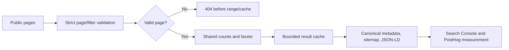

# MoralClean SEO performance dashboard

Tracking starts at the production release of the merged SEO implementation. This file is a comparison template: technical facts are verified from the repository and preview checks; search performance must be populated from Google Search Console, PostHog and Vercel after production release.

## Release snapshot

| Measure | Before release | After release | Source/status |
|---|---:|---:|---|
| Indexable public routes |  |  | Search Console Page indexing |
| Valid sitemap URLs | Existing production sitemap | 50 verified preview URLs | `docs/performance/cpu-http-verification-2026-10-12.json` |
| Steam Cleaners category | Present in legacy content/data | Removed from public category, navigation and sitemap; SEO guides retained | code + preview verification |
| Ride On Scrubber Dryer category | Added | Present and crawlable | preview build output |
| Invalid pagination responses | Could trigger Supabase `PGRST103` | HTTP 404 before range/cache work | 36 tests, 86 HTTP checks |
| Product card serialization sample | 16,121 bytes | 9,128 bytes | 43.4% lower; card-array serialization only |
| Production Fluid Active CPU | Not measured | Not yet measurable before release | Vercel Usage required |
| Organic clicks/impressions | Populate 28-day baseline | Populate equivalent post-release period | Search Console required |
| Qualified quote/contact enquiries | Populate 28-day baseline | Populate equivalent post-release period | PostHog/admin enquiry records |

## Implementation map

| Area | Implemented change | Verification |
|---|---|---|
| Products/blog pagination | Count preflight, strict page parsing, safe concurrent-deletion handling | Bun tests and local production-build HTTP checks |
| Catalog caching | Shared count/facet caches; no persistent arbitrary search/unknown-filter entries | request/cache assertions |
| SEO content | Guides, services, category buying advice, internal guide links and metadata preserved | preview build and route inventory |
| Category retirement | Steam Cleaners removed from public category data and links; its editorial guides remain | preview route/sitemap checks |
| New category | Ride On Scrubber Dryer remains in category routes and sitemap | build route output |
| Structured data | Existing applicable JSON-LD parsed on preview pages | 86 HTTP checks |
| Forms/admin | Existing implementations retained; no production records were changed by QA | code review; GET-only HTTP verification |

## Search Console comparison

Export the same date range for two equivalent 28-day periods. Keep the property, country, device and search type identical. Exclude the first few days after release when comparing stable performance, and annotate the release date.

| Search Console metric | Baseline 28 days | Post-release 28 days | Difference | Notes |
|---|---:|---:|---:|---|
| Total clicks |  |  |  |  |
| Total impressions |  |  |  |  |
| Average CTR |  |  |  |  |
| Average position |  |  |  |  |
| Indexed pages |  |  |  |  |
| Excluded pages |  |  |  |  |
| Crawled, currently not indexed |  |  |  |  |

Segment queries and pages into products, categories, services, guides and brand/search pages. Record the top 20 queries and the top 20 landing pages in each period. Search Console indexing confirmation is separate from technical eligibility; preview does not prove production indexing.

## PostHog and enquiry comparison

Use the existing PostHog property and the same production environment filter. Compare qualified events rather than raw pageviews.

| Funnel metric | Baseline 28 days | Post-release 28 days | Difference |
|---|---:|---:|---:|
| Product/category landing sessions |  |  |  |
| Quote form starts |  |  |  |
| Quote submissions |  |  |  |
| Contact submissions |  |  |  |
| Qualified enquiries |  |  |  |
| Submission rate |  |  |  |

Annotate traffic source, device, route family and bot/internal traffic. Keep admin dashboard counts separate from public conversion events.

## Vercel stability and CPU tracking

For the same traffic windows, record Fluid Active CPU hours, invocations, function errors and latency. Normalize CPU because raw totals change with traffic:

`CPU milliseconds per invocation = Fluid Active CPU hours × 3,600,000 ÷ invocations`

Track `PGRST103`, 500 responses, expected 404s, cache hits/writes, and the highest-volume query strings. Vercel Active CPU represents execution time; time waiting on database I/O is not itself proof of billed CPU savings. Use Vercel Usage for the team/project and keep environment and deployment windows consistent.

## Connector record

Serpstat was queried for `get_domain_regions_count` on `moralclean.com` as the required regional discovery step. It returned no data, so no ranking, traffic or keyword numbers are included. A Search Console property or a Serpstat tracked project with data is required for a valid before/after ranking chart. No Serpstat credentials were exposed or stored in the repository.

## Manual release checklist

1. In Vercel, confirm the preview deployment for the merged commit is READY and inspect the deployment logs for build/runtime errors.
2. On preview and then production after release, open the homepage, products, each category, Ride On Scrubber Dryer, product details, blog, guides, services, contact and quote flows on desktop and mobile.
3. Confirm `/products/category/steam-cleaners` is 404, while guide URLs mentioning steam cleaners still load where intended.
4. In Google Search Console, submit or refresh the sitemap, inspect representative URLs, request indexing only for priority pages, and review Page indexing/Crawl Stats after Google recrawls them.
5. Check canonical, robots, title, H1, description, image loading and applicable JSON-LD on representative pages.
6. Capture the baseline exports before release and fill this dashboard after 28 equivalent days. Do not compare preview traffic with production traffic.
7. In PostHog, verify quote/contact events and mark qualified enquiries consistently with the admin records.
8. In Vercel, review deployment logs, Function errors, invocations and Usage. Investigate unexpected 403s, 5xx responses, repeated invalid-page requests or unusual query-string cardinality.

Serpstat no-data result: 12 October 2026. Technical results are verified in preview; search performance and indexing remain post-release measurements.
